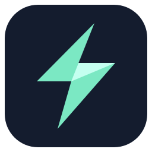

<p align="center"></p>
<h1 align="center">Sharpness Launcher</h1>
<p align="center">Minecraft Java Edition launcher with an integrated AI assistant and external agent support.</p>

Sharpness Launcher is an independent fork of [Prism Launcher](https://github.com/PrismLauncher/PrismLauncher). It keeps instance management, modpacks, Java management and the familiar Qt interface, and adds AI tools in the same application.

## Features

- Separate Minecraft instances, mod loaders, mods, resource packs and worlds.
- Offline profiles without first adding a Microsoft account. Offline profiles cannot join servers that require Microsoft authentication.
- **Settings → AI → Assistant**: ask your own local model or compatible provider about Minecraft, diagnose a crash, or plan a launcher feature.
- Review instance context before sending it. Logs are optional, API keys stay in memory, and answers never automatically modify files.
- **Settings → AI → External agents**: copy MCP configuration for your preferred client. The server is built into the launcher; no Python runtime is needed.
- Native builds for Windows, Linux and macOS. Supported architecture combinations are defined in the [build workflow](.github/workflows/build.yml).

## Getting started

Use **Accounts → Add Offline** to create a local profile, then add an instance. Open **AI Assistant** on the toolbar to configure a model. For a local provider such as Ollama, the default URL is `http://localhost:11434/v1/chat/completions`; enter a model you have installed. For a remote provider, enter its complete HTTPS chat-completions URL, model and API key.

Microsoft sign-in uses Prism Launcher's public application client ID by default, so Microsoft may identify the sign-in application as Prism Launcher. A custom client ID can be configured in Services or at build time. CurseForge requires an API key issued to this fork. Modrinth and offline profiles do not require those keys.

## Build

Clone with submodules, then use the CMake presets:

```sh
git submodule update --init --recursive
cmake --preset default
cmake --build --preset default --config Release
ctest --preset default --build-config Release
```

Requires CMake 3.28+, Ninja, a C++23 compiler, JDK 17 and Qt 6.8+ with NetworkAuth, SVG, image formats and the modules listed in CMake. C++ dependencies are managed by vcpkg. On Windows, `tools/build-windows.ps1` configures Visual Studio Build Tools, builds, tests and creates a runnable `install` directory. Use `-QtRoot` for a custom Qt installation.

See [FORK.md](FORK.md) for AI configuration, testing and architectural limits.

## Credits and license

Based on Prism Launcher, PolyMC and MultiMC. The AI integration is inspired by [Horizon](https://github.com/horizon-rust/horizon)'s agent-control architecture and implemented independently for Minecraft Java Edition. Offline-account behavior was studied in [PrismLauncher-Cracked](https://github.com/Diegiwg/PrismLauncher-Cracked).

Code is licensed under [GPL-3.0-only](LICENSE). Existing third-party notices and upstream asset licenses remain applicable. Sharpness's new icon is provided under GPL-3.0-only. Sharpness Launcher is not affiliated with Prism Launcher, Mojang or Microsoft.
